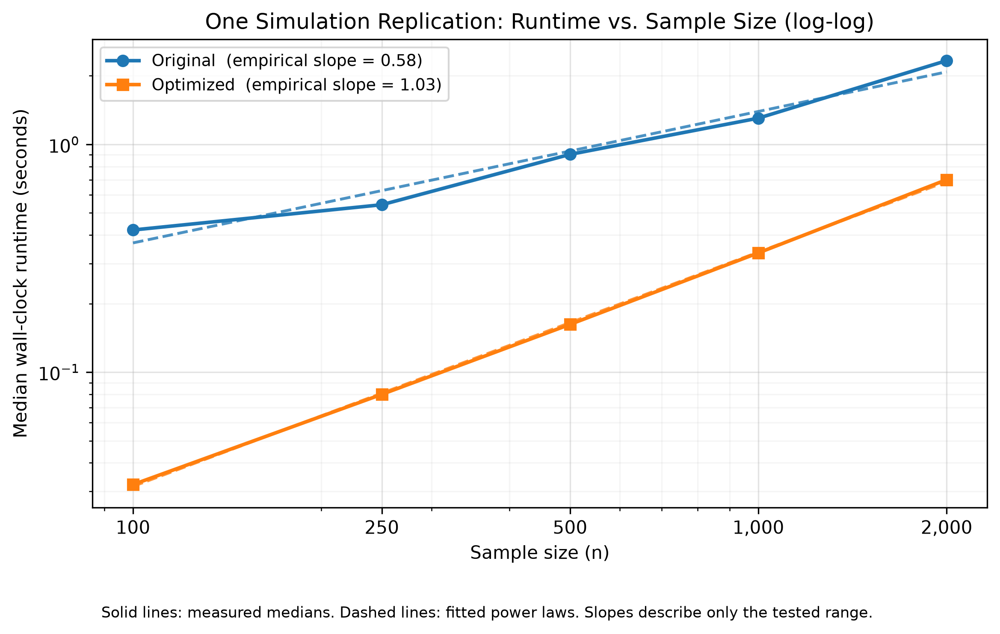
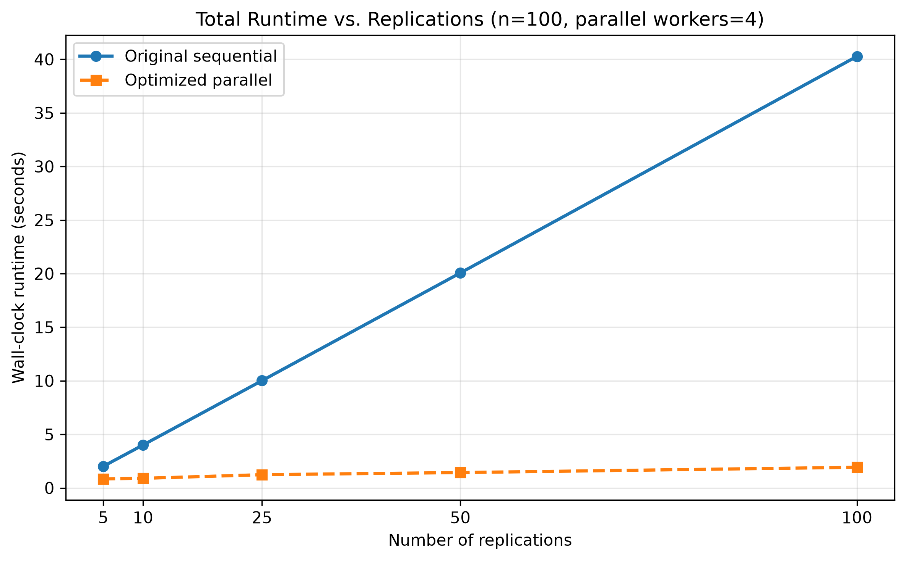

# Optimization Documentation for STATS 607 Project 3

In this documentation, we first introduce the optimization made to the original Project 2 code. Then we present evidence of performance gains from the optimization. We end the document with a discussion of the lessons learned.

## Optimization 1: Vectorization of `_compute_sn()`

### Problem identified

As discussed in `BASELINE.md`, baseline profiling revealed that `_compute_sn()` in `GeneralizedTetradTestGMM` has a high per-call runtime. This is likely partly because `_compute_phi_s()` is called repeatedly (for a total of $20000$ times) in `_compute_sn()`. Looking more closely, there seems to be two major problems with `_compute_sn()` and `_compute_phi_s()` in `GeneralizedTetradTestGMM`:

1. In `_compute_sn()`, $S_n$ is calculated using numerical integration over a grid of intervals (our current simulation uses a grid of $10000$ points). Therefore, the integrand needs to be evaluated at each of the $10000$ points on the grid, and the $10000$ evaluations are done sequentially using a for loop. This can slow down the code.
2. In each of the $10000$ loops in the numerical integration, `_compute_phi_s()` is called to compute the value of $\phi$ at the particular point on the grid. Each time `_compute_phi_s()` is called, the function computes two matrices that do not depend on $s$, so the same two matrices are recomputed in every of the $10000$ loops. This is inefficient because these two matrices could be pre-computed and directly passed into all calls of `_compute_phi_s()`.

### Solution implemented

I address the problems by vectorization/array programming. Specifically, the points on the grid are divided into batches. The optimized implementation jointly computes the value of the integrand at all points in the batch together, so the code only needs to loop over the batches rather than all of the $10000$ points. The code also pre-computes the two s-independent matrices, so it does not need to recompute the matrices for every batch.

### Code comparison

Code before optimization:

```python
def _compute_phi_s(self, s, bridge_function, bridge_function_type):
    """
    Compute phi_hat_s(O_j; bridge) as defined in Section 4.2 of the generalized tetrad paper.

    Parameters:
    s (float): The value of s for which to compute phi_hat_s.
    bridge_function (callable): The estimated bridge function.
    bridge_function_type (str): The type of bridge function to be used. If "h", then the Y-W bridge function is used; if "g", then the Y-Z bridge function is used.

    Returns:
    np.ndarray: The computed phi_hat_s(O_j; bridge) for all observations, with shape (N,).
    """
    if bridge_function_type == "h":
        proxy = self.W
        instrument = self.Z
    elif bridge_function_type == "g":
        proxy = self.Z
        instrument = self.W
    else:
        raise ValueError("bridge_function_type must be 'h' or 'g'.")

    # Calculate GMM moment functions
    D = np.column_stack([np.ones(self.N), proxy])
    B = np.column_stack([np.ones(self.N), instrument])

    residuals = self.Y - bridge_function(proxy)
    J = residuals[:, None] * B

    # Estimate Sigma_1
    M = -(B.T @ D) / self.N

    # Sigma_1 = M^{-1} because the GMM is just identified
    Sigma_1 = np.linalg.solve(M, np.eye(2))

    # Calculate the exponentiated values
    exp_values = np.exp(1j * s * self.X)

    C = (
        D.T @ exp_values / self.N
        - D.mean(axis=0) * exp_values.mean()
    )

    # Step 4: Compute phi_hat_s for all observations
    phi_s = C @ Sigma_1 @ J.T

    return phi_s

def _compute_sn(self, bridge_function, bridge_function_type, s_grid=None):
    '''
    Compute S_n as defined in Equation (12) in the generalized tetrad paper.

    Parameters:
    bridge_function (callable): The estimated bridge function.
    bridge_function_type (str): The type of bridge function to be used. If "h", then the Y-W bridge function is used; if "g", then the Y-Z bridge function is used.
    s_grid (np.ndarray, optional): A grid of s values for numerical integration. If None, a default grid will be used.

    Returns:
    float: The computed S_n value.
    '''
    if bridge_function_type == "h":
        proxy = self.W
    elif bridge_function_type == "g":
        proxy = self.Z
    else:
        raise ValueError("Invalid bridge function type.")

    residuals = self.Y - bridge_function(proxy)

    if s_grid is None:
        s_grid = np.linspace(0.001, 300, 10000)

    integrand = np.zeros(len(s_grid))

    for idx, s in enumerate(s_grid):
        exp_values = np.exp(1j * s * self.X)

        # Compute phi_hat_s(O_j; bridge) for all observations
        phi_s = self._compute_phi_s(
            s, bridge_function, bridge_function_type
        )

        # Compute the expression inside absolute value in Equation (12)
        terms = (
            residuals * (exp_values - exp_values.mean())
            + phi_s
        )

        integrand[idx] = np.sum(np.abs(terms)**2) / s**2

    # Integrate over positive s and multiply by 2
    sn = (2 / (self.N * np.pi)) * np.trapezoid(
        integrand, s_grid
    )

    return sn
```

Code after optimization:

```python
def _compute_sn(self, bridge_function, bridge_function_type, s_grid=None, batch_size=1000):
    '''
    Compute S_n as defined in Equation (12) in the generalized tetrad paper.

    Parameters:
    bridge_function (callable): The estimated bridge function.
    bridge_function_type (str): The type of bridge function to be used. If "h", then the Y-W bridge function is used; if "g", then the Y-Z bridge function is used.
    s_grid (np.ndarray, optional): A grid of s values for numerical integration. If None, a default grid will be used.

    Returns:
    float: The computed S_n value.
    '''
    if bridge_function_type == "h":
        proxy = self.W
        instrument = self.Z
    elif bridge_function_type == "g":
        proxy = self.Z
        instrument = self.W
    else:
        raise ValueError("bridge_function_type must be 'h' or 'g'.")

    residuals = self.Y - bridge_function(proxy)

    if s_grid is None:
        s_grid = np.linspace(0.001, 300, 10000)

    integrand = np.zeros(len(s_grid))
    #exp_centered = exp_values - exp_values.mean(axis=1, keepdims=True)
    #residual_times_exp_centered = residuals[None, :] * exp_centered

    # Calculate GMM moment functions
    D = np.column_stack([np.ones(self.N), proxy])
    B = np.column_stack([np.ones(self.N), instrument])

    J = residuals[:, None] * B

    # Estimate Sigma_1
    M = -(B.T @ D) / self.N

    # Sigma_1 = M^{-1} because the GMM is just identified
    Sigma_1 = np.linalg.solve(M, np.eye(2))

    D_centered = D - D.mean(axis=0)

    A = Sigma_1 @ J.T

    for start in range(0, len(s_grid), batch_size):
        end = min(start + batch_size, len(s_grid))
        s_batch = s_grid[start:end]

        exp_values = np.exp(
            1j * s_batch[:, None] * self.X[None, :]
        )

        exp_centered = (
            exp_values
            - exp_values.mean(axis=1, keepdims=True)
        )

        residual_times_exp_centered = residuals[None, :] * exp_centered

        C = exp_values @ D_centered / self.N
        phi = C @ A

        terms = residual_times_exp_centered + phi

        integrand[start:end] = (
            np.sum(np.abs(terms)**2, axis=1)
            / s_batch**2
        )

    '''for idx, s in enumerate(s_grid):
        exp_values = np.exp(1j * s * self.X)

        # Compute phi_hat_s(O_j; bridge) for all observations
        phi_s = self._compute_phi_s(
            s, bridge_function, bridge_function_type
        )

        # Compute the expression inside absolute value in Equation (12)
        terms = (
            residuals * (exp_values - exp_values.mean())
            + phi_s
        )

        integrand[idx] = np.sum(np.abs(terms)**2) / s**2'''

    # Integrate over positive s and multiply by 2
    sn = (2 / (self.N * np.pi)) * np.trapezoid(
        integrand, s_grid
    )

    return sn
```

Please note that after optimization, the `_compute_phi_s()` function is deleted because it is no longer needed. All $\phi$ computations are directly included in `_compute_sn()`.

### Performance impact

As shown in `profiling/results/original/profiling_bottleneck_original.txt`, `_compute_sn()` for `GeneralizedTetradTestGMM` has a per-call runtime of $4.867$ seconds before optimization. After optimization, as shown in `profiling/results/optimized/profiling_bottleneck_optimized`, the per-call runtime is reduced to $1.755$ seconds after optimization.

### Trade-offs

Before optimization, since the integrand is evaluated at only one point in each loop, only quantities related to that one point need to be stored in memory at each time. However, after optimization, the code needs to store the quantities related to all points in the batch, which increases memory cost. The batching is implemented to reduce the memory burden. However, the memory requirement of the optimized code should still generally be higher than the original code despite the batching.

## Optimization 2: Algorithmic improvement for delta matrix computation

### Problem identified

As discussed in `BASELINE.md`, baseline profiling revealed that `_compute_delta_matrix()` has moderate-to-high per-call runtime in both `GeneralizedTetradTestGMM` and `GeneralizedTetradTestPSMD`. In fact, this is expected because `_compute_delta_matrix()` has quadratic computational complexity (i.e. $O(n^2)$).

### Solution implemented

I address this problem by improving the algorithm used in delta matrix computation. In particular, notice that the delta matrix is mainly used to calculate a quadratic form in the form of $v^T \Delta v$ with $v$ being some vector, and this quadratic form is needed to compute $MGT_n$. Therefore, the optimized code employs a new algorithm to compute the quadratic form. The new algorithm does not require constructing the full delta matrix, which allows it to reduce the computational complexity to $O(n\log(n))$.

More specifically, the original implementation explicitly constructs the delta matrix $\Delta\in\mathbb{R}^{n\times n}$, defined by

$$
\Delta=HDH,
\qquad
D_{ij}=|X_i-X_j|,
\qquad
H=I_n-\frac{1}{n}\mathbf{1}\mathbf{1}^\top.
$$

However, the MGT statistic only requires the quadratic form

$$
v^\top\Delta v,
\qquad
v=\frac{R-\bar R\mathbf{1}}{n},
$$

where $R$ denotes the vector of residuals $Y-h(W)$ or $Y-g(Z)$, and $v$ is a centered vector. Since $v$ is centered, we have $Hv=v$, and therefore

$$
v^\top\Delta v
=v^\top HDHv
=v^\top Dv.
$$

Thus, the centering step in the delta matrix calculation can be omitted when evaluating this quadratic form. To efficiently compute $Dv$, sort the observations so that

$$
X_{(1)}\leq X_{(2)}\leq\cdots\leq X_{(n)},
$$

and rearrange $v$ according to the same ordering. Define the cumulative sums

$$
P_i=\sum_{j=1}^i v_{(j)},
\qquad
Q_i=\sum_{j=1}^i X_{(j)}v_{(j)}.
$$

Then, for each $i=1,\ldots,n$,

$$
\begin{aligned}
(Dv)_{(i)}
&=\sum_{j=1}^n|X_{(i)}-X_{(j)}|v_{(j)}\\
&=\sum_{j=1}^i(X_{(i)}-X_{(j)})v_{(j)}
+\sum_{j=i+1}^n(X_{(j)}-X_{(i)})v_{(j)}\\
&=X_{(i)}P_i-Q_i
+(Q_n-Q_i)-X_{(i)}(P_n-P_i)\\
&=X_{(i)}(2P_i-P_n)+Q_n-2Q_i.
\end{aligned}
$$

This constructs the desired quadratic form in $O(n\log(n))$ time.

### Code comparison

Code before optimization:

```python
def _compute_delta_matrix(self):
    '''
    Compute the delta matrix as defined in equation (11) in the generalized tetrad paper.

    Returns:
    np.ndarray: The computed delta matrix.
    '''
    abs_diff_matrix = np.abs(np.subtract.outer(self.X, self.X))
    term_1 = np.add.outer(np.sum(abs_diff_matrix, axis=0), np.sum(abs_diff_matrix, axis=1)) / self.N
    term_2 = np.sum(abs_diff_matrix) / (self.N)**2

    return abs_diff_matrix - term_1 + term_2

def _compute_mgtn(self, delta_matrix, bridge_function, bridge_function_type):
    '''
    Compute the mgtn vector as defined in equation (12) in the generalized tetrad paper.

    Parameters:
    delta_matrix (np.ndarray): The computed delta matrix.
    bridge_function (callable): The estimated bridge function.
    bridge_function_type (str): The type of bridge function to be used. If "h", then the Y-W bridge function is used; 
        if "g", then the Y-Z bridge function is used.

    Returns:
    np.ndarray: The computed mgtn vector.
    '''
    # Sanity check
    if bridge_function_type not in ["h", "g"]:
        raise ValueError("bridge_function must be either 'h' or 'g'.")

    if bridge_function_type == "h":
        self.A = self.W
    else:
        self.A = self.Z

    # Compute the residuals R(h) = Y - h(A) or R(g) = Y - g(A), and center them
    residuals = self.Y - bridge_function(self.A)
    centered_residuals = residuals - np.mean(residuals)

    # Compute the quadratic form inside the square root of MGT_n
    quadratic_form = (centered_residuals / self.N).T @ delta_matrix @ (centered_residuals / self.N)

    return np.sqrt(-quadratic_form)

def compute_test_statistic(self):
    '''
    Compute the test statistic for the generalized tetrad test.

    Returns:
    float: The computed test statistic.
    '''
    # Estimate the bridge functions
    h_hat = self._estimate_bridge_function(bridge_function_type="h")
    g_hat = self._estimate_bridge_function(bridge_function_type="g")

    # Compute the delta matrix
    delta_matrix = self._compute_delta_matrix()

    # Compute MGT_n for both bridge functions
    mgtn_h = self._compute_mgtn(delta_matrix, h_hat, bridge_function_type="h")
    mgtn_g = self._compute_mgtn(delta_matrix, g_hat, bridge_function_type="g")

    # Compute S_n for both bridge functions
    sn_h = self._compute_sn(h_hat, bridge_function_type="h")
    sn_g = self._compute_sn(g_hat, bridge_function_type="g")

    # Compute the test statistic as the maximum of the two S_n values
    test_statistic = self.N * (mgtn_h**2 + mgtn_g**2) / (sn_h + sn_g)

    return test_statistic
```

Code after optimization:

```python
def _compute_delta_matmul(self, v):
    '''
    Compute D @ v efficiently, where D[i, j] = abs(X[i] - X[j])

    Parameters:
    v (np.ndarray): The vector to multiply with the D matrix.

    Returns:
    np.ndarray: The computed matrix product of the D matrix with the vector v.
    '''

    # Sort X while also storing the original unsorted ordering
    order = np.argsort(self.X)
    X_sorted = self.X[order]

    # Rearrange v to match the sorted order of X
    v_sorted = v[order]

    # Find cumulative sums
    P = np.cumsum(v_sorted)
    Q = np.cumsum(X_sorted * v_sorted)

    # Compute the result of the product
    result_sorted = (X_sorted * (2 * P - P[-1]) + Q[-1] - 2 * Q)

    # Restore the original order
    result = np.zeros_like(result_sorted)
    result[order] = result_sorted

    return result

def _compute_mgtn(self, bridge_function, bridge_function_type):
    '''
    Compute the mgtn vector as defined in equation (12) in the generalized tetrad paper.

    Parameters:
    bridge_function (callable): The estimated bridge function.
    bridge_function_type (str): The type of bridge function to be used. If "h", then the Y-W bridge function is used; 
        if "g", then the Y-Z bridge function is used.

    Returns:
    np.ndarray: The computed mgtn vector.
    '''
    # Sanity check
    if bridge_function_type not in ["h", "g"]:
        raise ValueError("bridge_function must be either 'h' or 'g'.")

    if bridge_function_type == "h":
        self.A = self.W
    else:
        self.A = self.Z

    # Compute the residuals R(h) = Y - h(A) or R(g) = Y - g(A), and center them
    residuals = self.Y - bridge_function(self.A)
    centered_residuals = residuals - np.mean(residuals)

    # Compute the quadratic form inside the square root of MGT_n
    v = centered_residuals / self.N
    delta_matmul = self._compute_delta_matmul(v)
    quadratic_form = v.T @ delta_matmul

    return np.sqrt(-quadratic_form)

def compute_test_statistic(self):
    '''
    Compute the test statistic for the generalized tetrad test.

    Returns:
    float: The computed test statistic.
    '''
    # Estimate the bridge functions
    h_hat = self._estimate_bridge_function(bridge_function_type="h")
    g_hat = self._estimate_bridge_function(bridge_function_type="g")

    # Compute MGT_n for both bridge functions
    mgtn_h = self._compute_mgtn(h_hat, bridge_function_type="h")
    mgtn_g = self._compute_mgtn(g_hat, bridge_function_type="g")

    # Compute S_n for both bridge functions
    sn_h = self._compute_sn(h_hat, bridge_function_type="h")
    sn_g = self._compute_sn(g_hat, bridge_function_type="g")

    # Compute the test statistic as the maximum of the two S_n values
    test_statistic = self.N * (mgtn_h**2 + mgtn_g**2) / (sn_h + sn_g)

    return test_statistic
```

Note that in `GeneralizedTetradTestPSMD`, the new, faster algorithm is applied only to the computation of $MGT_n$. The full delta matrix still needs to be constructed in some other parts of the method.

### Performance impact

Before optimization, as shown in `profiling/results/original/profiling_bottleneck_original.txt`, `_compute_delta_matrix()` has a per-call runtime of $1.083$ seconds in `GeneralizedTetradTestGMM` and $0.526$ seconds in `GeneralizedTetradTestPSMD`. After optimization, as shown in `profiling/results/optimized/profiling_bottleneck_optimized`, the per-call runtime of `_compute_delta_matmul()` (which is the successor of `_compute_delta_matrix()`) is reduced to $0.000$ seconds in `GeneralizedTetradTestGMM` and $0.001$ seconds in `GeneralizedTetradTestPSMD`. Please note that this is only a rough comparison because it does not factor into changes made to `_compute_mgtn()` and `compute_test_statistic()` during optimization.

### Trade-offs

The original implementation of `_compute_delta_matrix()` strictly follows the formula given in the original paper and is generally easy to follow. On the other hand, the optimized code might be difficult to understand without additional explanations. This can also make the optimized code more challenging to maintain in the long term than the original code because the mathematics involved is more intricate and the learning curve for the maintainer is likely steeper.

## Optimization 3: Parallelizing the simulation replications

### Problem identified

The original simulation involves running a large number of replicates sequentially. Although each individual replication does not take a lot of time, the combined runtime for sequentially executing all replications can be particularly high.

### Solution implemented

I address this problem by using `ProcessPoolExecutor` to run the simulation replications in parallel.

### Code comparison

Code before optimization:

```python
def run_simulations(num_replications, num_samples_list, parameters_list, alpha, start_seed, raw_path=None):
    """
    Run multiple simulation replications.

    Parameters:
    num_replications (int): The number of simulation replications to run.
    num_samples_list (list): A list of sample sizes to be tested.
    parameters_list (list): A list containing the lists of parameters for the data-generating mechanism for all the settings. 
        It should look like: [[alpha_2_1, beta_2_1, delta_1], [alpha_2_2, beta_2_2, delta_2], ...].
    alpha (float): The significance level for the hypothesis tests.
    start_seed (int): The random seed for the first replication.
    raw_path (str): The path where the raw results will be saved as a .csv file. If None, the results will not be saved to a file.
    agg_path (str): The path where the aggregated results will be saved as a .csv file. If None, the results will not be saved to a file.

    Returns:
    pd.DataFrame: Two DataFrames, one containing the raw simulation results and another containing the aggregated rejection rates.
    """

    raw_results = {
        'num_replications': [],
        'num_samples': [],
        'alpha_2': [],
        'beta_2': [],
        'delta': [],
        'p_value_classical': [],
        'p_value_generalized_gmm': [],
        'p_value_generalized_psmd': [],
        'rejection_decision_classical': [],
        'rejection_decision_generalized_gmm': [],
        'rejection_decision_generalized_psmd': [], 
        'replication_id': []
    }
    for num_samples in tqdm(num_samples_list, desc="Sample Sizes"):
        for parameters in tqdm(parameters_list, desc="Data-generating Mechanisms"):
            # Run the tests and record the p-values for each simulation replication
            for i in tqdm(range(num_replications), desc="Simulation Replications"):
                current_seed = start_seed + i
                result = run_one_simulation(num_samples=num_samples, 
                                            alpha_2=parameters[0], 
                                            beta_2=parameters[1], 
                                            delta=parameters[2], 
                                            seed=current_seed)
                # Store the raw results
                raw_results['num_replications'].append(num_replications)
                raw_results['num_samples'].append(num_samples)
                raw_results['alpha_2'].append(parameters[0])
                raw_results['beta_2'].append(parameters[1])
                raw_results['delta'].append(parameters[2])
                raw_results['p_value_classical'].append(result['classical'])
                raw_results['p_value_generalized_gmm'].append(result['generalized_gmm'])
                raw_results['p_value_generalized_psmd'].append(result['generalized_psmd'])
                raw_results['rejection_decision_classical'].append(result['classical'] < alpha)
                raw_results['rejection_decision_generalized_gmm'].append(result['generalized_gmm'] < alpha)
                raw_results['rejection_decision_generalized_psmd'].append(result['generalized_psmd'] < alpha)
                raw_results['replication_id'].append(i + 1)

    # Save and return the results
    df_raw = pd.DataFrame(raw_results)
    if raw_path is not None:
        df_raw.to_csv(raw_path, index=False)
    return df_raw
```

Code after optimization:

```python
def run_simulations_parallel(num_replications, num_samples_list, parameters_list, alpha, start_seed, raw_path=None, n_workers=4):
    """
    Run multiple simulation replications in parallel using the optimized code.

    Parameters:
    num_replications (int): The number of simulation replications to run.
    num_samples_list (list): A list of sample sizes to be tested.
    parameters_list (list): A list containing the lists of parameters for the data-generating mechanism for all the settings. 
        It should look like: [[alpha_2_1, beta_2_1, delta_1], [alpha_2_2, beta_2_2, delta_2], ...].
    alpha (float): The significance level for the hypothesis tests.
    start_seed (int): The random seed for the first replication.
    raw_path (str): The path where the raw results will be saved as a .csv file. If None, the results will not be saved to a file.
    agg_path (str): The path where the aggregated results will be saved as a .csv file. If None, the results will not be saved to a file.
    n_workers (int): The number of worker processes to use for parallel execution.

    Returns:
    pd.DataFrame: Two DataFrames, one containing the raw simulation results and another containing the aggregated rejection rates.
    """

    raw_results = {
        'num_replications': [],
        'num_samples': [],
        'alpha_2': [],
        'beta_2': [],
        'delta': [],
        'p_value_classical': [],
        'p_value_generalized_gmm': [],
        'p_value_generalized_psmd': [],
        'rejection_decision_classical': [],
        'rejection_decision_generalized_gmm': [],
        'rejection_decision_generalized_psmd': [], 
        'replication_id': []
    }

    with ProcessPoolExecutor(max_workers=n_workers) as executor:
        for num_samples in tqdm(num_samples_list, desc="Sample Sizes"):
            for parameters in tqdm(parameters_list, desc="Data-generating Mechanisms"):
                seeds = range(start_seed, start_seed + num_replications)

                # Run the tests and record the p-values for each simulation replication; parallelized
                results = executor.map(
                    run_one_simulation,
                    repeat(num_samples),
                    repeat(parameters[0]),
                    repeat(parameters[1]),
                    repeat(parameters[2]),
                    seeds,
                    chunksize=5
                )

                # Store the raw results
                for i, result in enumerate(tqdm(results, total=num_replications, desc="Simulation Replications Results")):
                    raw_results['num_replications'].append(num_replications)
                    raw_results['num_samples'].append(num_samples)
                    raw_results['alpha_2'].append(parameters[0])
                    raw_results['beta_2'].append(parameters[1])
                    raw_results['delta'].append(parameters[2])
                    raw_results['p_value_classical'].append(result['classical'])
                    raw_results['p_value_generalized_gmm'].append(result['generalized_gmm'])
                    raw_results['p_value_generalized_psmd'].append(result['generalized_psmd'])
                    raw_results['rejection_decision_classical'].append(result['classical'] < alpha)
                    raw_results['rejection_decision_generalized_gmm'].append(result['generalized_gmm'] < alpha)
                    raw_results['rejection_decision_generalized_psmd'].append(result['generalized_psmd'] < alpha)
                    raw_results['replication_id'].append(i + 1)

    # Save and return the results
    df_raw = pd.DataFrame(raw_results)
    if raw_path is not None:
        df_raw.to_csv(raw_path, index=False)
    return df_raw
```

### Performance impact

`profiling/code/comparison/profiling_parallelization_comparison.py` provides code that compares the runtime of sequential vs. parallelized execution of the whole set of simulations in Project 2. Code with Optimizations 1 and 2 is used for both the sequential and parallelized executions. The results are saved to `profiling/results/comparison/profiling_parallelization_comparison.txt`. The sequential execution used a wall-clock time of about $3672$ seconds, while the parallelized execution only used about $1587$ seconds of wall-clock time. This shows parallelization results in a significant improvement in terms of runtime.

*Note: The CPU time is also reported in `profiling/results/comparison/profiling_parallelization_comparison.txt` for completeness. However, the wall-clock time is used as the primary performance metric for evaluating parallelization because the reported CPU time for the parallel implementation only measures the main process and excludes worker-process CPU time (i.e. it underestimates the true total CPU time).*

### Trade-offs

Compared to the original sequential code, the parallelized code might require higher CPU and memory usage.

## Profiling Evidence

`profiling/results/original/profiling_bottleneck_original.txt` includes the profiling results for the original code, while `profiling/results/optimized/profiling_bottleneck_optimized.txt` includes the profiling results for the optimized code. Comparing these files shows how the runtime of each function is changed by the optimization. 

The following visualization compares the original and optimized code in terms of the runtime (measured by wall-clock time) of a single simulation replication (using `run_one_simulation()`) against the sample size. We fix `alpha_2=0.1, beta_2=0.2, delta=0`, and vary `num_samples`. Notably, when running the single replication, the optimized code is faster than the original code for all of the sample sizes tested, and the gap in the runtime widens as the sample size increases.



The following visualization compares the original and optimized code in terms of the runtime (measured by wall-clock time) of a multiple simulation replication (using `run_simulations()`) against the replication count (i.e. the number of replications). We fix `alpha_2=0.1, beta_2=0.2, delta=0, num_samples=100, n_workers=4`, and vary the number of simulation replications. Notably, when running the multiple replications, the optimized code is faster than the original code for all of the replication counts tested, and the gap in the runtime widens as the replication count increases. Specifically, the runtime of the optimized code remains nearly flat as the replication count increases, which is likely due to parallelization.




## Lessons Learned

I think Optimization 1 provided the best return on investment. The idea behind Optimization 1 is relatively simple. Despite the simplicity, it speeds up each simulation replication by about 6 seconds (3 seconds per call, and 2 calls per simulation replication). 

Indeed, I was initially surprised by how much time `_compute_phi_s()` consumes in total in the original code. I did not expect it to take up a lot of time because it is relatively simple and straightforward, and it belongs to a reasonable complexity class. However, it turned out that the repetitive computation made this straightforward function a computational bottleneck.

I think Optimization 3 also provided the very great return on investment when the simulation involves running multiple independent simulation replications. Implementing parallelization is not very difficult. However, it provides significant runtime reduction when a large number of replications are run.

Optimization 2 also resulted in a very concrete speed-up of the code. However, I think it involves more significant trade-offs than the other two optimizations. The new algorithm for computing the quadratic form is relatively complicated. Therefore, it might be relatively difficult to maintain in the long term: the maintainer might need to spend a long time to understand it, a random reader can find the algorithm unintuitive, and the algorithm might need to change if the generalized tetrad test method is updated.

